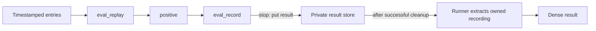

# Eval entries and recorder handoff

Status: agreed entry representation, scalar replay, and recorder handoff.
Collection publication profiles retain their separate proposed status.
The general source-timing rules retain their language-specification status.

## API

| Core API | Contract |
| --- | --- |
| `EvalEntry<T>` | Ordinary struct with `time: datetime` and `value: delta<T>` |
| `eval_replay<T>(const items: list<EvalEntry<T>>) -> T` | Source of the entries' publications |
| `eval_record<T>(input: T)` | Sink that retains publications and hands them off at stop |
| `append<V>(values: list<V>, item: V) -> list<V>` | Ordinary value helper; returns the existing entries followed by `item` |

The entry uses the language's
[`delta<T>`](https://github.com/hhenson/hgl_spec/blob/main/spec/language/types-and-values.md)
ordinary value type. For a scalar T, including a nullable scalar, its delta
is T. For a collection, the delta describes changes under its admitted
profile; a held collection snapshot is not implicitly such a delta.

## Rules

- **CEVAL-7.** Replay and recording use `list<EvalEntry<T>>`. Every entry is
  a present publication with an absolute evaluation time and an owned delta.
  Replay times strictly increase within each input and are not before the
  run origin. All inputs use the same origin. Silence has no entry; a
  published null is an entry whose scalar delta is null, not silence.
- **CEVAL-8.** The designated replay and record have ordinary HGL bodies.
  Replay publishes each entry at its time (CEVAL-2/3). Record starts with an
  empty per-run buffer. On a valid, modified input it appends the evaluation
  time and an independently retained delta (CEVAL-4). `append` preserves
  order and ordinary value ownership; later changes cannot alter an earlier
  retained entry. This requires no replay-specific or recorder-specific
  native function.
- **CEVAL-9.** The runner binds the designated recorder's `global_state` to
  a fresh private result store. Ordinary program nodes use the program
  store; program writes and supplied seeds cannot address the private store.
  Its `"result"` slot is initially absent. The recorder's `stop` puts its
  complete buffer there, including `[]`. Only the runner-created designated
  recorder receives this binding; a name or import grants no such access.
- **CEVAL-10.** The runner constructs and starts the graph, evaluates until
  scheduled work is exhausted, then completes stop/cleanup before extracting
  the result. Failure takes precedence over any recording (CEVAL-6). After
  successful cleanup it must obtain `list<EvalEntry<T>>` from the private
  `"result"` slot; absence or extraction failure fails eval. Extraction
  retains an owned value before run resources are released. Dense results
  follow TST-6: end at the last publication, or `[]` for an empty recording.
  Input length supplies neither a run bound nor result padding.

An outputless target has no recorder or comparable result (CEVAL-1). A source
with no temporal inputs needs no replay. Both still run through cleanup.
The [capability API](capabilities.md) supplies ordinary clock/store access;
graph construction, running, and extraction are test-host responsibilities.

## Wired scalar example

Accepted complete-module illustration of the core bodies, target, and generated
root. These bodies specify the API; this document is not executable core code.
`append` above and the endpoint/store APIs are supplied by core.

```hgl
module examples.eval_recording

struct EvalEntry<T> {
    time: datetime
    value: delta<T>
}

fn eval_replay<T>(const items: list<EvalEntry<T>>) -> T {
    for item in items {
        yield item.time: item.value
    }
}

fn eval_record<T>(input: T) {
    cache entries: list<EvalEntry<T>> = []
    inject clock, global_state
    when valid(input) && modified(input) {
        entries = append(entries, EvalEntry<T>(
            time: clock.evaluation_time,
            value: delta_value(input)
        ))
    }
    stop { put(global_state, "result", entries) }
}

fn positive(value: i64) -> i64 {
    when {
        if value > 0 { return value }
    }
}

# The graph root generated for eval(positive, value: ...).
fn wired_positive(const items: list<EvalEntry<i64>>) {
    let replayed = eval_replay<i64>(items)
    let filtered = positive(replayed)
    eval_record<i64>(filtered)
}

test silent_ticks {
    assert eval(positive, value: [7, _, 0, 9, _]) == [7, _, _, 9]
}

test empty_recording {
    assert eval(positive, value: []) == []
    assert eval(positive, value: [0, _, 0, _]) == []
}
```

The illustration names its helpers locally to show their bodies. Eval itself
selects core's designated functions, not these names through user lookup.



## Run and extract

For `silent_ticks`, O is the runner-supplied origin and this example's minimum
step is `1us` (one microsecond). Input normalization produces:

```text
items = [EvalEntry<i64>(time: O,       value: 7),
         EvalEntry<i64>(time: O + 2us, value: 0),
         EvalEntry<i64>(time: O + 3us, value: 9)]
```

The runner invokes `wired_positive(items)`, then runs and extracts as follows.
This is host-neutral pseudocode specifying the sequence, not new HGL spellings
or a prescribed native ABI. Graph-construction failure also fails eval and
releases construction resources.

```text
run = fresh_simulation(origin: O, minimum_step: 1us)
private_store = fresh_empty_store()
root = build_graph(wired_positive, items: items)
bind_global_state(root.program_nodes, run.program_store)
bind_global_state(root.designated_recorder, private_store)

execution = start_and_evaluate_until_idle(root, run)
cleanup = stop_all_started_nodes(root, run)  # also after execution failure
if execution.failed or cleanup.failed:
    release(root, run, private_store)
    fail_eval(execution, cleanup)

recording = read_owned<list<EvalEntry<i64>>>(private_store, "result")
release(root, run, private_store)
if recording.missing: fail_missing_recording()
if recording.failed: fail_eval(recording.error)
return densify(recording.value, origin: O, step: 1us)
```

The table abbreviates an entry as `(time, value)`.

| Time | Replay publication | `positive` publication | Entry appended |
| --- | --- | --- | --- |
| O | `7` | `7` | `(O, 7)` |
| O + 1us | None; no evaluation scheduled | None | None |
| O + 2us | `0` | None: no return | None |
| O + 3us | `9` | `9` | `(O + 3us, 9)` |

There is no scheduled event at O + 4us. Stop stores the two entries, extraction
owns them, and densification inserts the two gaps: `[7, _, _, 9]`.

| Empty input case | Scheduled replay publications | Private slot after stop | Extracted result |
| --- | --- | --- | --- |
| `[]` | None | Present, holding `[]` | `[]` |
| `[0, _, 0, _]` | Zero at O and O + 2us; target never publishes | Present, holding `[]` | `[]` |

| Handoff condition | Eval outcome |
| --- | --- |
| Successful cleanup; present nonempty recording | Construct result from its entries |
| Successful cleanup; present empty recording | `[]` |
| Successful cleanup; missing recording | Missing-recording failure (CEVAL-6) |
| Execution, cleanup, or extraction failure | Failure, never partial success or empty success |
| Target writes `"result"` in its program store | No change to recorder storage |

The [scalar conformance cases](https://github.com/hhenson/hgl_core/blob/main/tests/conformance/eval_recording.hgl)
cover silence, both empty cases, published null, program-store isolation, and
retention across eval calls. Missing-recording and cleanup-failure injection
require the test host; these are not observations ordinary HGL code can forge.
