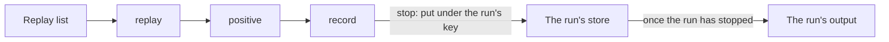

# Execution

Status: CRUN-1 through CRUN-8 are agreed. Outside events in real time, a
stop a node asks for, and observers of a run have no rules yet.

## Scope and API

The [language specification](https://github.com/hhenson/hgl_spec/blob/main/spec/language/program-execution.md)
says what an entry is and how one is admitted (RUN-1, RUN-2). This contract
says what a run of one is: what it is given, when its cycles happen, how it
ends, and what it gives back.

| Core API | Contract |
| --- | --- |
| `smallest_step`, `never`, `earliest_start`, `forever`, `latest_end` | Constants: the least step between two cycles, a `duration`, and four instants, each a `datetime` (CRUN-3) |
| `RunConfig` | The type of the capability `run_config` (CAP-7): `start: datetime?`, `end: datetime?`, `length: duration?`, each null where the configuration leaves it out. No call constructs one |
| `replay<T>(const items: list<tuple<datetime, delta<T>>>) -> T` | A source of the publications `items` holds |
| `record<T>(input: T, const key: str)` | A sink that retains each publication of `input` and puts them in the store under `key` at stop |

## Rules

- **CRUN-1.** A run takes one entry, its `const` arguments, and one
  configuration, a `RunConfig`, which the run is given and the program
  does not make (the language's RUN-6). It builds the entry's graph, starts
  it, evaluates zero or more cycles, and stops it, once each. To run an
  entry again is another run, with its own state, store and recording. A
  run is a simulation or in real time, as the word it is written with says
  (the language's RUN-3): an `eval` is a simulation and a `run` is in real
  time.
- **CRUN-2.** A run's configuration is fixed for the run. `start` is
  inclusive and `end` exclusive: no cycle runs before `start`, and none at
  or after `end`. A `start` left out is the earliest start in simulation
  and the host clock's present time in real time. `length` gives the end
  counted from the start the run has, given or not: a run with a `length`
  ends as one whose `end` is that start and `length` later. A
  configuration with both an `end` and a `length` is refused before the
  run's graph is built, an HGL error with code `run.end_and_length`. With
  neither, a simulation ends when nothing is scheduled, and a real-time
  run when its host stops it.
- **CRUN-3.** Evaluation time is constant within a cycle, and each cycle's is
  later than the one before by one microsecond or more: the smallest step,
  `smallest_step`. Core names four instants beside it. `never`,
  `1970-01-01T00:00:00Z`, is before every evaluation time, and `forever`,
  `2262-04-11T00:00:00Z`, after every one: no cycle runs at either. The
  earliest start, `earliest_start`, is one smallest step after `never`, and
  the latest end, `latest_end`, one smallest step before `forever`: a run's
  start is no earlier than the first and its end no later than the second.
  A run whose start or end lies outside them is an HGL error with code
  `run.bounds`.
- **CRUN-4.** In simulation a cycle runs at the next scheduled time without
  waiting, and the run ends when nothing is scheduled before its `end`. The
  same entry, arguments and configuration give the same cycles and the same
  publications, where no node reads the host clock.
- **CRUN-5.** In real time a cycle runs when the host clock reaches its
  scheduled time, and at once when that time has passed.
- **CRUN-6.** However a run ends, every node that started is stopped, in the
  reverse of the order they started in. A failure names its node and its
  phase: construction, start, evaluation or stop. A run that failed has no
  output.
- **CRUN-7.** A run has one store (CAP-6). Before its graph is built the
  store holds what the run's application put there before its run statement
  (the language's UNIT-14), and nothing else: the store of a test's eval is
  then empty. A graph that injects the store puts values there as it is
  built (the language's FN-9), before any node of that graph starts: a
  graph built while the run is under way does so then. Nothing outside the
  program puts a value there.
- **CRUN-8.** The output of a run of an entry whose result type is T is a
  `list<tuple<datetime, delta<T>>>` (the language's TST-16): one tuple for
  each publication of the result, in time order, holding the evaluation time
  and what was published. An entry with no result has no output. The run
  wires `record` to the entry's result under the key `"run.output"`, and its
  output is the value under that key once the run has stopped. That key is
  the run's: a program that names it is rejected (CAP-6).

## Replay and record

`replay` and `record` are ordinary HGL: no native function is theirs alone.
They are source in `hgl/core/core.hgl`, and are not exported: a run wires
them, and no module names them. A program may so use either name for a
declaration of its own.

```hgl
fn replay<T>(const items: list<tuple<datetime, delta<T>>>) -> T {
    for item in items {
        yield item[0]: item[1]
    }
}

fn record<T>(input: T, const key: str) {
    cache entries: list<tuple<datetime, delta<T>>> = []
    inject clock, global_state
    when valid(input) && modified(input) {
        let change: result<delta<T>, error> = delta_value(input)
        if is_ok(change) { append(entries, (clock.evaluation_time, change.value)) }
    }
    stop { put(global_state, key, entries) }
}
```

`replay` is a source that yields each entry at its time. `record` keeps
its recording in a `cache`, which [`append`](list-operations.md) gives one
more tuple at each publication. It reads the delta where a `result` is
taken (END-3): in a cycle in which a value only leaves a window of a
duration there is none, and it adds no tuple.

Illustration, complete module:

```hgl
module examples.execution

fn positive(value: i64) -> i64 {
    when value > 0 { return value }
}

test silent_ticks {
    assert eval positive(value: [7, _, 0, 9, _]) == [7, _, _, 9]
}
```

The entry the eval generates is this graph, which the run writes and no
module does: `replay` is the run's to name.

```hgl
fn wired_positive(const value: list<tuple<datetime, delta<i64>>>) -> i64 {
    positive(replay<i64>(value))
}
```



The eval gives no configuration, so the run of `wired_positive` is a
simulation with every field of its configuration left out. S is its start,
the earliest start. The replay list is `[(S, 7), (S + 2us, 0), (S + 3us, 9)]`.

| Time | `replay` publishes | `positive` publishes | Tuple recorded |
| --- | --- | --- | --- |
| S | `7` | `7` | `(S, 7)` |
| S + 1us | Nothing: no cycle is scheduled | Nothing | None |
| S + 2us | `0` | Nothing: no return | None |
| S + 3us | `9` | `9` | `(S + 3us, 9)` |

Nothing is scheduled at S + 4us, so the run ends. `record` puts its two
tuples under the run's key at stop, and they are the run's output. Eval
writes it dense (TST-6): `[7, _, _, 9]`.

| The run | Its output |
| --- | --- |
| Stops with a recording that has tuples | Those tuples |
| Stops with an empty recording | `[]` |
| Stops with nothing under the run's key | None: a failure (CEVAL-6) |
| Fails in construction, start, evaluation or stop | None: the failure (CRUN-6) |
