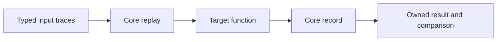

# Core testing and eval

Status: test ownership and eval wiring (CEVAL-1) are agreed.
The remaining eval profile and pack mechanics are proposed.

## Agreed

- **CONF-1.** Core owns all runtime conformance expectations and their shared
  executable cases. Test outcomes concern observable behavior.
- **CONF-2.** Conformance uses core and its declared native providers, with no
  optional library. Shared fixtures have one source definition.
- **CONF-3.** Runtime conformance cases form a test-only module, `conformance`,
  assembled from parts. Rejection cases form `conformance.rejections`.
  Production artifacts do not ship either module.
- **CONF-4.** Ordinary implementation tests remain distinct from portable
  conformance. Target adapters may supply host observations, never new expected
  results. Compiler internals are tested in their implementation project.
- **CEVAL-1.** Eval wires designated core replay to each temporal input and
  designated core record to the target output, if present. It binds const
  arguments once for the run as ordinary values. Imports and overloads
  cannot replace the designated replay or record.

## Proposed eval boundary



The [language specification](https://github.com/hhenson/hgl_spec/blob/main/spec/language/tests-and-eval.md)
owns source checking, trace notation, and harness comparison. Core proposes:

- **CEVAL-2.** Typed ordinary input data omits silent cells. Preserve the dense
  input horizon separately. `TimedValue<T>` carries an absolute time and the
  publication delta for originating temporal shape T; its exact declaration
  and admitted profile remain to be accepted.
- **CEVAL-3.** Replay publishes present entries, including equal scalar values.
  Silence publishes nothing. A compute fixture writes its own output.
- **CEVAL-4.** A started recorder initializes an empty recording and independently
  retains each output publication and evaluation time. Later writes cannot
  change an earlier capture.
- **CEVAL-5.** Each eval creates a fresh run and recording. Preserve the input
  horizon and any later output ticks when constructing a dense result.
- **CEVAL-6.** Failure and missing recording data are errors. Neither becomes a
  successful empty result. Internal recorder keys must not collide with source
  or owner-supplied state.

## Eval examples

These illustrations use the proposed trace and eval profiles.

### Scalar input and output

Replay feeds `copy_tick`. Record captures its own publications.

```hgl
module examples.eval_scalar

fn copy_tick(value: i64) -> i64 {
    when { return value }
}

test scalar_trace {
    assert eval(copy_tick, value: [7, _, 7]) == [7, _, 7]
}
```

### Multiple inputs and const configuration

`left` and `right` each have replay. `factor` is one scalar for the run.

```hgl
module examples.eval_configured

fn scaled_sum(left: i64, right: i64, const factor: i64) -> i64 {
    when { return (left + right) * factor }
}

test unequal_input_horizons {
    assert eval(scaled_sum,
                left: [2, _, 5],
                right: [_, 3, _, 4, _],
                factor: 2) == [_, 10, 16, 18, _]
}
```

| Cycle | `left` tick | `right` tick | Recorded output |
| --- | --- | --- | --- |
| `t1` | `2` | `_` | `_` while `right` is invalid |
| `t2` | `_` | `3` | `10` using retained `left = 2` |
| `t3` | `5` | `_` | `16` using retained `right = 3` |
| `t4` | `_` | `4` | `18` using retained `left = 5` |
| `t5` | `_` | `_` | `_` in the longer input's horizon |

Call an ordinary value helper directly for an all-scalar test.

```hgl
module examples.test_value_helper

const fn twice_value(value: i64) -> i64 => value * 2

test scalar_value {
    assert twice_value(7) == 14
}
```

### Collection input

In this proposed set profile, replay applies each input cell as a delta.
Record captures the output deltas.

```hgl
module examples.eval_set

fn copy_set_delta(members: set<i64>) -> set<i64> {
    when { return delta_value(members) }
}

test set_delta_trace {
    assert eval(copy_set_delta, members: [
        delta<set<i64>>(added: [1, 2]),
        _,
        delta<set<i64>>(added: [3], removed: [1])
    ]) == [
        delta<set<i64>>(added: [1, 2]),
        _,
        delta<set<i64>>(added: [3], removed: [1])
    ]
}
```

The final set is `{2, 3}`. Its last recorded tick adds `3` and removes `1`.
Member `2` stays in the set through both updates.

### Sink

```hgl
module examples.eval_sink

fn log_tick(value: i64) {
    inject logger
    when { info(logger, str(value)) }
}

test run_log_sink {
    eval(log_tick, value: [7, _, 9])
}
```

Eval wires replay to `log_tick` and runs the sink. The effect to check here
is a log call with `"7"` at `t1` and with `"9"` at `t3`. The eval call runs
the graph. Checking effects uses an observation appropriate to each sink.

### Pull source

This proposed illustration assumes the finite source first evaluates at run
start and eval runs through source completion. The duration keys in the
expected trace are offsets from run start.

```hgl
module examples.eval_source

fn emit_two(const first: i64) -> i64 {
    yield 1s: first
    yield 1s: first + 1
}

test source_trace {
    assert eval(emit_two, first: 7) == [1s: 7, 2s: 8]
}
```

Eval binds `first` and attaches record. The source schedules its own
publications and finishes after the second yield.

## Proposed first cases

| Observation | Input | Expected output |
| --- | --- | --- |
| Equal publications remain ticks | `[7, _, 7, 9]` | `[7, _, 7, 9]` |
| Silent horizon survives | `[_, _, _]` | `[_, _, _]` |
| Empty input remains empty | `[]` | `[]` |
| Leading/trailing silence survives | `[_, 7, _, _]` | `[_, 7, _, _]` |
| Zero, false, and empty text are present | Typed present cells | Same present cells |
| Captures are independent | Publish A, then B | First capture remains A |
| Runs are independent | Nonempty run, then empty run | Second recording is empty |

The [shared fixtures](https://github.com/hhenson/hgl_core/blob/main/tests/conformance/README.md)
cover dense scalar traces. Target adapters supply observations that require
test-host access.
