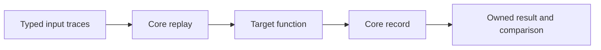

# Core testing and eval

Status: test ownership and CEVAL-1 through CEVAL-6 are agreed.
The remaining eval profile and pack mechanics are proposed.

## Agreed

- **CONF-1.** Core owns all runtime conformance expectations and their shared
  executable cases. Test outcomes concern observable behavior.
- **CONF-2.** Conformance uses core and its declared native providers, with no
  optional library. Shared fixtures have one source definition.
- **CONF-3.** Runtime conformance cases form a test-only module, `conformance`,
  assembled from parts. Rejection cases form `conformance.rejections`.
  Production artifacts do not ship either module.
- **CONF-4.** Ordinary implementation tests remain distinct from portable
  conformance. Target adapters may supply host observations, never new expected
  results. Compiler internals are tested in their implementation project.
- **CEVAL-1.** Eval wires designated core replay to each temporal input and
  designated core record to the target output, if present. It binds const
  arguments once for the run as ordinary values. Imports and overloads
  cannot replace the designated replay or record.
- **CEVAL-2.** Each temporal input has a typed replay list of present
  publications. Each entry pairs its absolute evaluation time with the
  publication delta for that input's temporal shape. Eval derives all times
  from a common run origin. A dense placeholder locates any later entries
  and adds no replay entry or run bound. An empty replay schedules no work.
  Simulation stops when scheduled work is exhausted (RUN-3).
- **CEVAL-3.** Replay publishes each scalar entry at its timestamp, including
  repeated values. Silent slots publish nothing. Replay applies collection
  entries under their shape's publication rules.
- **CEVAL-4.** Record initializes an empty recording at start. Each output
  publication adds an entry with its evaluation time and an independently
  retained delta. Later writes leave earlier entries intact.
- **CEVAL-5.** Each eval creates a fresh run with independent node state and
  recording. Eval constructs a dense result from that recording under TST-6.
- **CEVAL-6.** A failed run or a missing required recording makes eval
  fail. On run failure, eval performs cleanup and reports the failure even
  if the recorder captured earlier ticks. A successful run with an
  initialized empty recording yields `[]`. Recorder storage is isolated
  from program state and supplied seeds.

## Eval wiring



The [language specification](https://github.com/hhenson/hgl_spec/blob/main/spec/language/tests-and-eval.md)
owns source checking, trace notation, and harness comparison.

## Eval examples

These illustrations use the proposed trace and eval profiles.

### Scalar input and output

Replay feeds `copy_tick`. Record captures its own publications.

```hgl
module examples.eval_scalar

fn copy_tick(value: i64) -> i64 {
    when { return value }
}

test scalar_trace {
    assert eval(copy_tick, value: [7, _, 7]) == [7, _, 7]
}
```

### Repeated scalar replay

Eval wires replay to `count_publications` and records the counter's output.

```hgl
module examples.replay_ticks

fn count_publications(value: i64) -> i64 {
    state count: i64 = 0
    when {
        count += 1
        return count
    }
}

test replay_preserves_equal_ticks {
    assert eval(count_publications, value: [7, _, 7, 7, _]) ==
        [1, _, 2, 3]
}
```

| Cycle | Replay tick to `value` | `count_publications` output tick |
| --- | --- | --- |
| `t1` | `7` | `1` |
| `t2` | `_` | `_` |
| `t3` | `7` | `2` |
| `t4` | `7` | `3` |

The trailing placeholder schedules no work at `t5`.

The [core fixture](https://github.com/hhenson/hgl_core/blob/main/tests/conformance/scalar_eval.hgl)
checks the recorded counter trace.

### Multiple inputs and const configuration

`left` and `right` each have replay. `factor` is one scalar for the run.

```hgl
module examples.eval_configured

fn scaled_sum(left: i64, right: i64, const factor: i64) -> i64 {
    when { return (left + right) * factor }
}

test unequal_input_lengths {
    assert eval(scaled_sum,
                left: [2, _, 5],
                right: [_, 3, _, 4],
                factor: 2) == [_, 10, 16, 18]
}
```

| Cycle | `left` tick | `right` tick | Recorded output |
| --- | --- | --- | --- |
| `t1` | `2` | `_` | `_` while `right` is invalid |
| `t2` | `_` | `3` | `10` using retained `left = 2` |
| `t3` | `5` | `_` | `16` using retained `right = 3` |
| `t4` | `_` | `4` | `18` using retained `left = 5` |

Call an ordinary value helper directly for an all-scalar test.

```hgl
module examples.test_value_helper

const fn twice_value(value: i64) -> i64 => value * 2

test scalar_value {
    assert twice_value(7) == 14
}
```

### Scalar and collection replay

Eval wires separate replay sources to `enabled` and `members`, then records
the output of `relay_members`. This example uses the proposed set delta profile.

```hgl
module examples.eval_mixed_replay

fn relay_members(enabled: bool, members: set<i64>) -> set<i64> {
    when {
        if enabled && modified(members) {
            return delta_value(members)
        }
    }
}

test mixed_replay {
    assert eval(relay_members,
                enabled: [true, _, true],
                members: [
                    _,
                    delta<set<i64>>(added: [1, 2]),
                    _,
                    delta<set<i64>>(added: [3], removed: [1])
                ]) == [
        _,
        delta<set<i64>>(added: [1, 2]),
        _,
        delta<set<i64>>(added: [3], removed: [1])
    ]
}
```

`t1` is run start. Each following slot advances one engine step. The replay
entries carry the corresponding absolute times.

| Input | Replay entries |
| --- | --- |
| `enabled` | `(t1, true)`, `(t3, true)` |
| `members` | `(t2, add {1, 2})`, `(t4, add {3}, remove {1})` |

| Cycle | `enabled` tick | `members` tick | Retained `members` | Recorded output |
| --- | --- | --- | --- | --- |
| `t1` | `true` | `_` | Invalid | `_` |
| `t2` | `_` | Add `{1, 2}` | `{1, 2}` | Add `{1, 2}` |
| `t3` | `true` | `_` | `{1, 2}` | `_` |
| `t4` | `_` | Add `{3}`, remove `{1}` | `{2, 3}` | Add `{3}`, remove `{1}` |

At `t3` the repeated `true` wakes `relay_members`, which stays silent
because `members` has no delta. At `t4` it uses the retained `true`.
Both replay sources are exhausted after `t4`. The
[core fixture](https://github.com/hhenson/hgl_core/blob/main/tests/conformance/mixed_eval.hgl)
checks the recorded output.

### Recording retention

Eval wires replay to `update_members` and attaches record to its output.
This example uses the proposed set delta profile.

```hgl
module examples.record_retention

fn update_members(command: i64) -> set<i64> {
    when {
        if command == 1 {
            return delta<set<i64>>(added: [1, 2])
        }
        if command == 2 {
            return delta<set<i64>>(added: [3], removed: [1])
        }
    }
}

test record_retains_each_delta {
    assert eval(update_members, command: [1, _, 2]) == [
        delta<set<i64>>(added: [1, 2]),
        _,
        delta<set<i64>>(added: [3], removed: [1])
    ]
}

test record_can_be_empty {
    assert eval(update_members, command: []) == []
    assert eval(update_members, command: [0]) == []
}
```

`D1` is `delta<set<i64>>(added: [1, 2])` and `D2` is
`delta<set<i64>>(added: [3], removed: [1])`.

| Slot | `command` tick | `update_members` output tick | Recording after the slot |
| --- | --- | --- | --- |
| Start | — | — | `[]` |
| `t1` | `1` | `D1` | `[(t1, D1)]` |
| `t2` | `_` | `_` | `[(t1, D1)]` |
| `t3` | `2` | `D2` | `[(t1, D1), (t3, D2)]` |

`t2` locates the next publication. It schedules no evaluation.
A recorder that borrows a reused delta buffer could return `[D2, _, D2]`.

| Empty case | What runs | Dense result |
| --- | --- | --- |
| `command: []` | Replay schedules no events. | `[]` |
| `command: [0]` | `update_members` evaluates once without publishing. | `[]` |

The [core fixtures](https://github.com/hhenson/hgl_core/blob/main/tests/conformance/record_eval.hgl)
check both cases.

### Run isolation

Each call wires its own replay, `count_publications`, and recorder.

```hgl
module examples.eval_isolation

fn count_publications(value: i64) -> i64 {
    state count: i64 = 0
    when {
        count += 1
        return count
    }
}

test runs_are_independent {
    assert eval(count_publications, value: [7, _, 7]) == [1, _, 2]
    assert eval(count_publications, value: []) == []
    assert eval(count_publications, value: [7, _, 7]) == [1, _, 2]
}
```

| Eval call | Replay input | Dense result | Observation |
| --- | --- | --- | --- |
| First | `[7, _, 7]` | `[1, _, 2]` | The counter publishes twice. |
| Second | `[]` | `[]` | The recording starts empty. |
| Third | `[7, _, 7]` | `[1, _, 2]` | The counter starts at zero again. |

The [core fixture](https://github.com/hhenson/hgl_core/blob/main/tests/conformance/scalar_eval.hgl)
checks all three calls.

### Failed runs and missing recordings

Eval wires replay to `checked_ratio` and records its output.

```hgl
module examples.eval_failure

fn checked_ratio(divisor: f64) -> f64 {
    when { return (6.0 /{zero: .error} divisor)? }
}

test eval_preserves_failure {
    assert eval(checked_ratio, divisor: []) == []
    assert eval(checked_ratio, divisor: [2.0]) == [3.0]
    assert raises("numeric.division_by_zero") {
        eval(checked_ratio, divisor: [2.0, 0.0])
    }
}
```

| Input or condition | Recorder observation | Eval outcome |
| --- | --- | --- |
| `divisor: []` | Starts empty and receives no ticks | `[]` |
| `divisor: [2.0]` | Captures `3.0` at `t1` | `[3.0]` |
| `divisor: [2.0, 0.0]` | Captures `3.0` at `t1`. The node fails at `t2`. | `numeric.division_by_zero` escapes after cleanup |
| Required recording unavailable after successful execution | No recording to extract | Missing recording error |

The [core fixture](https://github.com/hhenson/hgl_core/blob/main/tests/conformance/failure_eval.hgl)
checks the first three outcomes. The fourth requires the test host to make
the recording unavailable.

### Sink

```hgl
module examples.eval_sink

fn log_tick(value: i64) {
    inject logger
    when { info(logger, str(value)) }
}

test run_log_sink {
    eval(log_tick, value: [7, _, 9])
}
```

Eval wires replay to `log_tick` and runs the sink. The effect to check here
is a log call with `"7"` at `t1` and with `"9"` at `t3`. The eval call runs
the graph. Checking effects uses an observation appropriate to each sink.

### Pull source

This proposed illustration assumes the finite source first evaluates at run
start and eval runs through source completion. The duration keys in the
expected trace are offsets from run start.

```hgl
module examples.eval_source

fn emit_two(const first: i64) -> i64 {
    yield 1s: first
    yield 1s: first + 1
}

test source_trace {
    assert eval(emit_two, first: 7) == [1s: 7, 2s: 8]
}
```

Eval binds `first` and attaches record. The source schedules its own
publications and finishes after the second yield.

## Proposed first cases

| Observation | Input | Expected output |
| --- | --- | --- |
| Equal publications remain ticks | `[7, _, 7, 9]` | `[7, _, 7, 9]` |
| All-silent input supplies no replay entries | `[_, _, _]` | `[]` |
| Empty input remains empty | `[]` | `[]` |
| Leading silence locates the publication | `[_, 7, _, _]` | `[_, 7]` |
| Zero, false, and empty text are present | Typed present cells | Same present cells |

The [shared fixtures](https://github.com/hhenson/hgl_core/blob/main/tests/conformance/README.md)
cover dense traces. Target adapters supply observations that require
test-host access.
