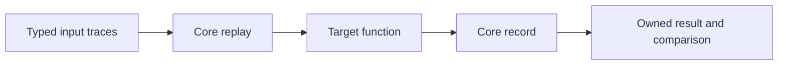

# Core testing and eval

Status: agreed ownership; runtime details and pack mechanics remain proposed.

## Agreed

- **CONF-1.** Core owns all runtime conformance expectations and their shared
  executable cases. Test outcomes concern observable behavior.
- **CONF-2.** Conformance uses core and its declared native providers, with no
  optional library. Shared fixtures have one source definition.
- **CONF-3.** Runtime conformance cases form a test-only module, `conformance`,
  assembled from parts. Rejection cases form `conformance.rejections`.
  Production artifacts do not ship either module.
- **CONF-4.** Ordinary implementation tests remain distinct from portable
  conformance. Target adapters may supply host observations, never new expected
  results. Compiler internals are tested in their implementation project.

## Proposed eval boundary

The [language specification](https://github.com/hhenson/hgl_spec/blob/main/spec/testing-and-eval.md)
owns source checking, trace notation, and harness comparison. Core proposes:

- **CEVAL-1.** Eval uses designated core replay and record implementations.
  Imports and optional candidates cannot change that selection. An outputless
  target has no output recorder.
- **CEVAL-2.** Typed ordinary input data omits silent cells. Preserve the dense
  input horizon separately. `TimedValue<T>` carries an absolute time and the
  publication delta for originating temporal shape T; its exact declaration
  and admitted profile remain to be accepted.
- **CEVAL-3.** Replay publishes present entries, including equal scalar values.
  Silence publishes nothing. A compute fixture writes its own output.
- **CEVAL-4.** A started recorder initializes an empty recording and independently
  retains each output publication and evaluation time. Later writes cannot
  change an earlier capture.
- **CEVAL-5.** Each eval creates a fresh run and recording. Preserve the input
  horizon and any later output ticks when constructing a dense result.
- **CEVAL-6.** Failure and missing recording data are errors. Neither becomes a
  successful empty result. Internal recorder keys must not collide with source
  or owner-supplied state.

## Proposed first cases

| Observation | Input | Expected output |
| --- | --- | --- |
| Equal publications remain ticks | `[7, _, 7, 9]` | `[7, _, 7, 9]` |
| Silent horizon survives | `[_, _, _]` | `[_, _, _]` |
| Empty input remains empty | `[]` | `[]` |
| Leading/trailing silence survives | `[_, 7, _, _]` | `[_, 7, _, _]` |
| Zero, false, and empty text are present | Typed present cells | Same present cells |
| Captures are independent | Publish A, then B | First capture remains A |
| Runs are independent | Nonempty run, then empty run | Second recording is empty |

Add controls for outputless targets, unequal input horizons, a failed run,
and missing recording state. Use target instrumentation when an observation
cannot be expressed in HGL. No cases are implemented by this document.

## Open

- Replay/record declarations, storage operations, key preparation, and cleanup.
- Test-host controls for failure injection, seeds, and native observations.
- Portable result schema, test selection, manifest, profiles, and completeness.
- Source-error catalogue and the location of language-only rejection fixtures.
- Timed traces, source-only eval bounds, structural deltas, and references.
